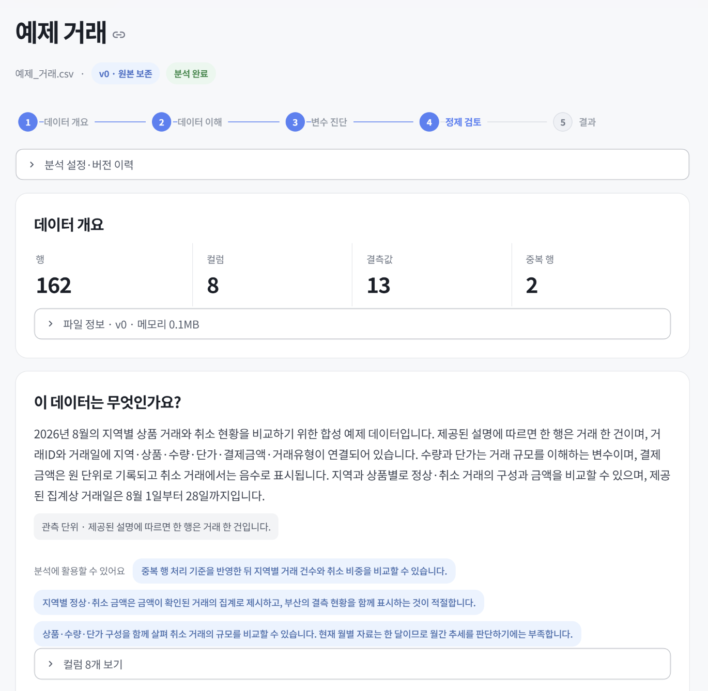
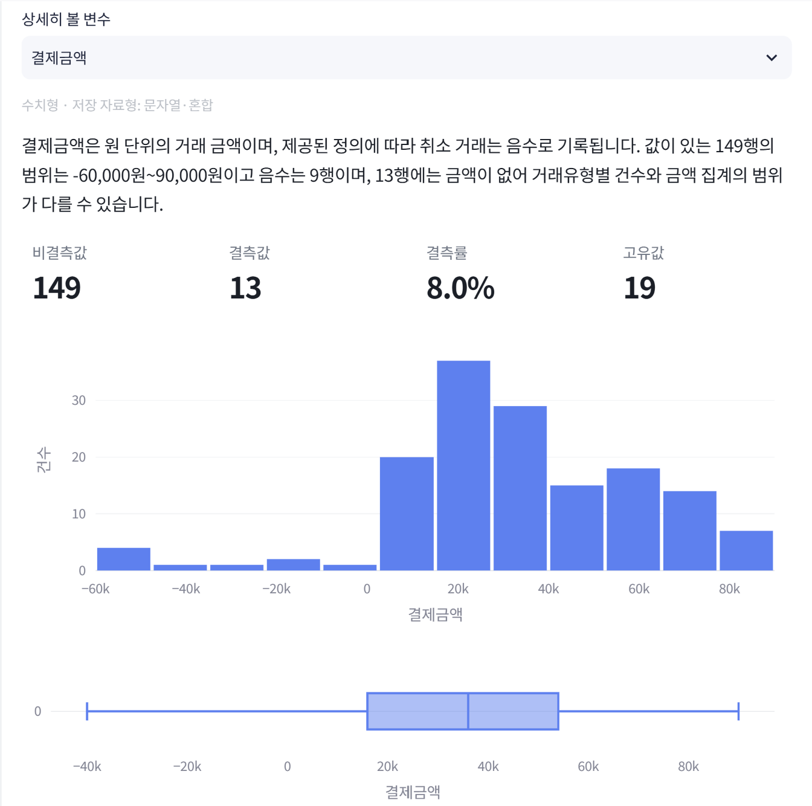
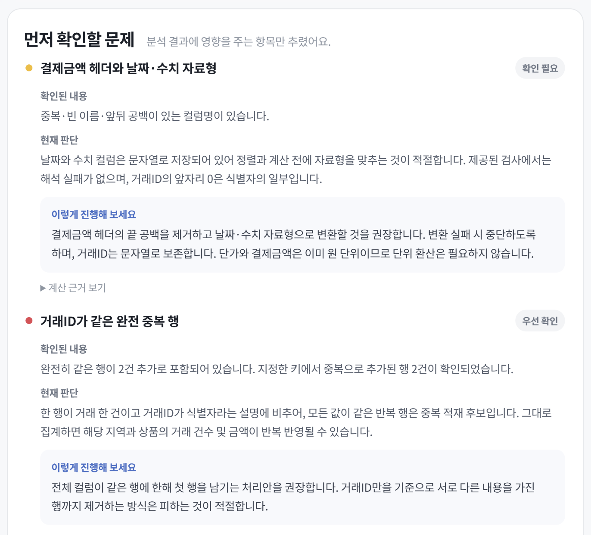
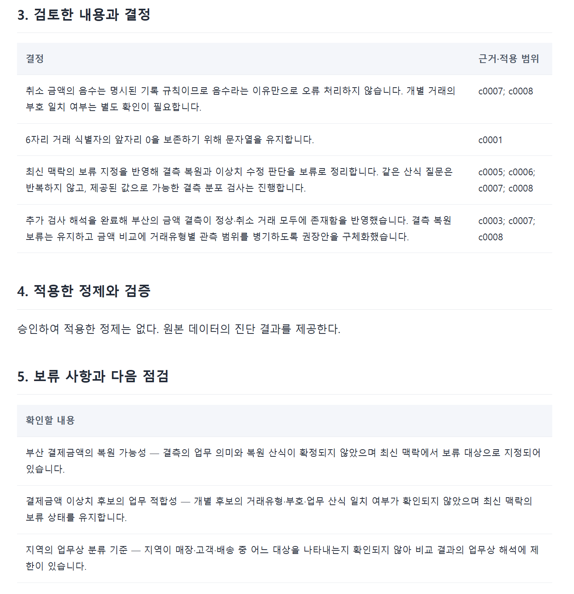

# AI/ML 스터디

저희는 **다양한 알고리즘 기법과 데이터 분석 기반의 문제 해결**에 관심 있는 3인 스터디 팀입니다.

 

## 학습 커리큘럼

<table>
  <thead>
    <tr>
      <th width="300" align="left">1주차 → 알고리즘 학습</th>
      <th width="300" align="left">2주차 → 논문·사례 리뷰</th>
      <th width="300" align="left">3주차 데이터 분석 미니 프로젝트</th>
    </tr>
  </thead>
  <tbody>
    <tr>
      <td valign="top">- 알고리즘의 수학적 구현 원리 학습</td>
      <td valign="top">- 알고리즘을 활용한 논문 및 사례 보고서 리딩  - 알고리즘의 활용 분야·사례 그리고 장단점과 한계점에 관해 토의</td>
      <td valign="top">- 학습한 알고리즘을 실제 데이터를 바탕으로 데이터 분석에 활용  - 문제 정의 - 분석 기획 - EDA 및 분석 - 결과와 인사이트 도출 - 분석 보고서 작성 후 토의</td>
    </tr>
    <tr>
      <td align="center" valign="top">
         
        베이지안 분류기의 우도와 로그우도  
         
        SVM 커널 함수
      </td>
      <td align="center" valign="top">
         
        Naive Bayes 기반 감성분석 논문 사례 정리  
         
        PCA 주성분 논문 요약
      </td>
      <td align="center" valign="top">
         
        Bayesian Network 적용 미니 프로젝트 보고서  
         
        SVM 미니 프로젝트 코드
      </td>
    </tr>
  </tbody>
</table>

 

## 사용 툴 · 참여 팀원

<table>
  <thead>
    <tr>
      <th width="600" align="left">사용 툴</th>
      <th width="300" align="left">참여 팀원</th>
    </tr>
  </thead>
  <tbody>
    <tr>
      <td valign="top">
        
 <strong>Python</strong> 데이터 EDA · 분석 · 모델링 · 시각화 · 통계 분석

        
 <strong>PostgreSQL</strong> 데이터 ETL · 조회 · 분석

        
 <strong>Notion</strong> 일정 관리 · 협업 · 산출물 기록 · 보고서 작성

      </td>
      <td valign="top">
        
<strong>박중현</strong> <a href="https://github.com/JHPark-kor">JHPark-kor</a>

        
<strong>강재성</strong> <a href="https://github.com/jaesung0306">jaesung0306</a>

        
<strong>신정윤</strong> <a href="https://github.com/wjddbsl03">wjddbsl03</a>

      </td>
    </tr>
  </tbody>
</table>

  

## 스터디 기록

아래 링크를 클릭하시면 필기노트, 페이퍼 리뷰 보고서, 미니 프로젝트 분석 보고서와 관련 코드를 보실 수 있습니다.

<!-- 동일 알고리즘은 rowspan으로 묶는다. 주차를 추가할 때 해당 rowspan도 함께 갱신한다. -->
<!-- 제출 여부는 원본 파일을 확인한 주차만 갱신한다. -->

<table>
  <thead>
    <tr>
      <th>주차</th>
      <th>알고리즘</th>
      <th>내용</th>
      <th>상세 내용</th>
      <th>회의록</th>
    </tr>
  </thead>
  <tbody>
    <tr>
      <td>W3</td>
      <td rowspan="3"><a href="algorithms/pca/README.md">PCA</a></td>
      <td><strong>수학 원리 학습</strong> 분산 최대화 · 고유값 분해 · 커널 PCA</td>
      <td><a href="algorithms/pca/math_theory/README.md">PCA 수학 원리</a></td>
      <td>—</td>
    </tr>
    <tr>
      <td>W4</td>
      <td><strong>논문·사례 리뷰</strong> PCA 기반 복합지표 · 공정 이상 탐지 기상 재해 피해 추정</td>
      <td><a href="algorithms/pca/paper_review/README.md">PCA 논문 리뷰</a></td>
      <td>—</td>
    </tr>
    <tr>
      <td>W5</td>
      <td><strong>데이터 분석 미니 프로젝트</strong> 문화 접근성 · 반도체 불량 분류 AI 의존도 예측</td>
      <td><a href="algorithms/pca/analysis/README.md">PCA 미니 프로젝트</a></td>
      <td>—</td>
    </tr>
    <tr>
      <td>W6</td>
      <td rowspan="3"><a href="algorithms/svm/README.md">SVM</a></td>
      <td><strong>수학 원리 학습</strong> 마진 최대화 · KKT 조건 · 커널 함수</td>
      <td><a href="algorithms/svm/math_theory/README.md">SVM 수학 원리</a></td>
      <td>—</td>
    </tr>
    <tr>
      <td>W7</td>
      <td><strong>논문·사례 리뷰</strong> One-Class SVM 낙상 탐지 웨이퍼 분류 · SVM 영화 리뷰 감성분석</td>
      <td><a href="algorithms/svm/paper_review/README.md">SVM 논문 리뷰</a></td>
      <td><a href="meetings/w7_svm_paper_review.md">후속 학습 기록</a></td>
    </tr>
    <tr>
      <td>W8</td>
      <td><strong>데이터 분석 미니 프로젝트</strong> 사기 거래 탐지 · 반도체 불량 분류 SNS 감성분석</td>
      <td><a href="algorithms/svm/analysis/README.md">SVM 미니 프로젝트</a></td>
      <td><a href="meetings/w8_svm_analysis.md">기록 확인</a></td>
    </tr>
    <tr>
      <td>W9</td>
      <td rowspan="3"><a href="algorithms/bayesian/README.md">Bayesian</a></td>
      <td><strong>수학 원리 학습</strong> 최대우도·로그우도 · 나이브 베이즈 베이지안 네트워크</td>
      <td><a href="algorithms/bayesian/math_theory/README.md">Bayesian 수학 원리</a></td>
      <td>—</td>
    </tr>
    <tr>
      <td>W10</td>
      <td><strong>논문·사례 리뷰</strong> Naive Bayes 신조어 감성분석 제조 Cycle Time · 임상 결측 정보 활용</td>
      <td><a href="algorithms/bayesian/paper_review/README.md">Bayesian 논문 리뷰</a></td>
      <td><a href="meetings/w10_bayesian_paper_review.md">회의록</a></td>
    </tr>
    <tr>
      <td>W11</td>
      <td><strong>데이터 분석 미니 프로젝트</strong> 문화예술 관람 의향 · 반도체 불량 분류 신용카드 연체 구조 설계</td>
      <td><a href="algorithms/bayesian/analysis/README.md">Bayesian 미니 프로젝트</a></td>
      <td><a href="meetings/w11_bayesian_analysis.md">회의록</a></td>
    </tr>
    <tr>
      <td>W12</td>
      <td>선형회귀</td>
      <td><strong>수학 원리 토의</strong> 최소제곱법 · 로지스틱 회귀 · 볼록함수</td>
      <td><a href="https://app.notion.com/p/3ef917c0e6408077907be85f4461eb26">선형회귀 수학 원리</a></td>
      <td><a href="meetings/w12_linear_math_theory.md">회의록</a></td>
    </tr>
  </tbody>
</table>

  

## 사이드 프로젝트

### 1. Agent AI 기반 데이터 분석 EDA 자동화 플랫폼 — DataPrep Studio

데이터 파악·품질 점검·전처리를 지원하고, 메타데이터 사전과 전처리 분석 보고서 초안을 작성하는 도구.

**문제:** 낯선 데이터 이해, 반복 점검·전처리부터 코드·메타데이터·보고서 작성까지 분석 준비에 많은 시간이 듭니다.

**솔루션:** 파일을 올리면 Agent AI가 진단·EDA를 자연어로 설명합니다. 사용자가 검토·승인하면 데이터 테이블·메타데이터 사전·전처리 분석 보고서 초안을 받습니다.

<table>
  <tbody>
    <tr>
      <td width="25%" valign="top" align="center"><strong>데이터 파악</strong>  전체 구조·의미 확인</td>
      <td width="25%" valign="top" align="center"><strong>변수 진단</strong>  분포·결측·이상치 점검</td>
      <td width="25%" valign="top" align="center"><strong>정제 검토</strong>  근거·권장 처리 확인</td>
      <td width="25%" valign="top" align="center"><strong>결과 보고</strong>  결정·적용 여부·보류 기록</td>
    </tr>
  </tbody>
</table>

[실행 방법·코드](projects/eda-automation/README.md) · [과제 정의서](projects/eda-automation/files/project-definition.pdf)

### 2. Agent AI 기반 Notion - GitHub 과제물 연동 자동화 프로세스 구축

[코드 다운로드](projects/notion-github-sync/files/notion-github-sync-source.zip)
