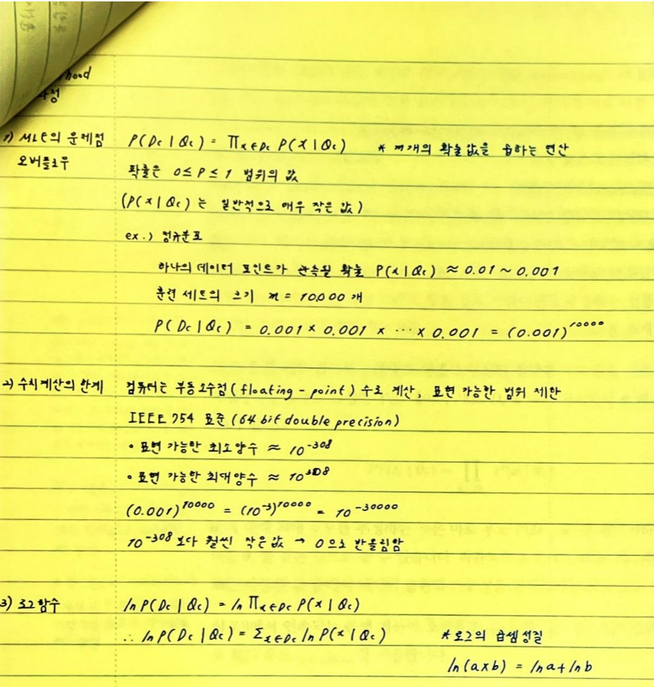
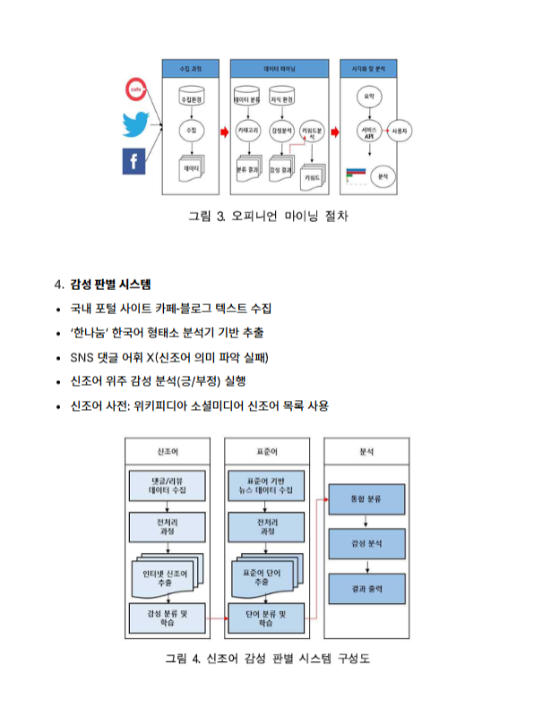
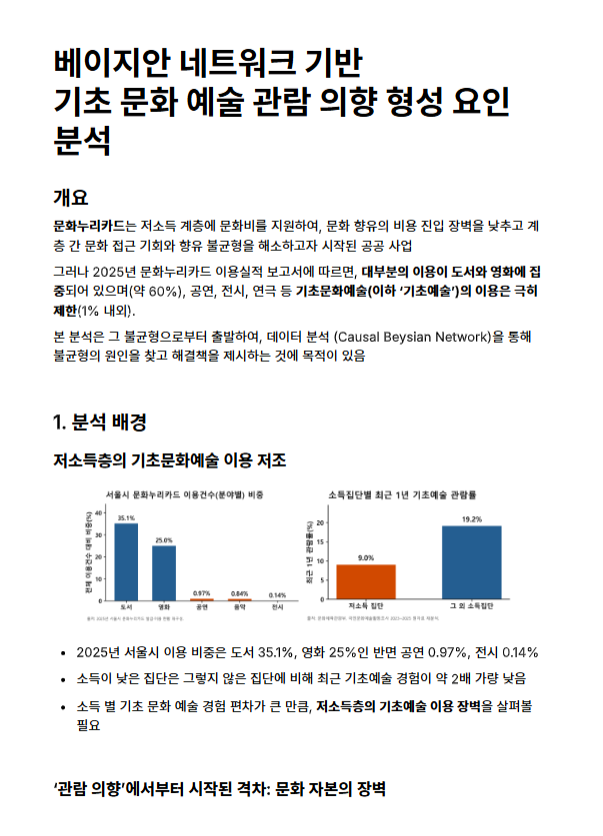
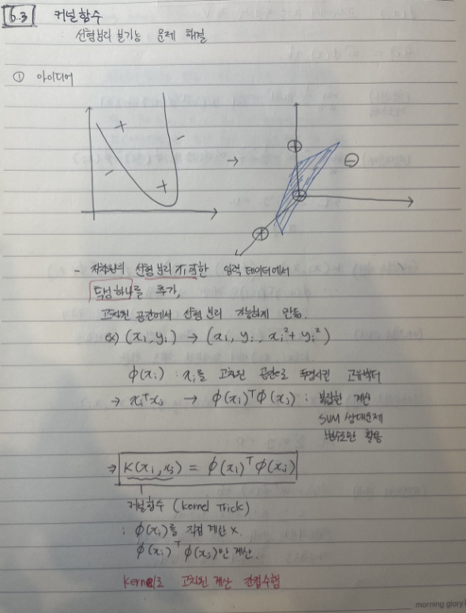
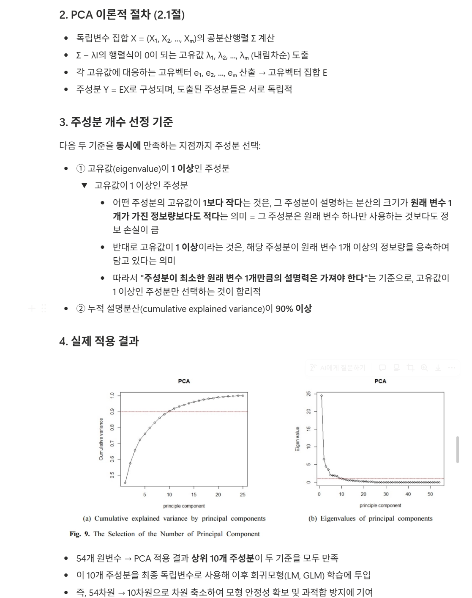
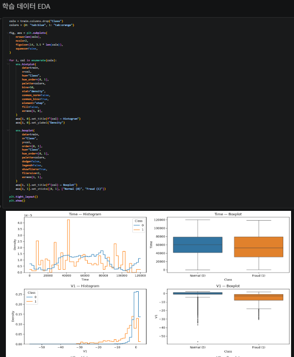

# AI/ML 스터디

> 〈어떤 스터디인지, 무엇을 목표로 하는지 보여주는 한 줄 소개〉

〈배우는 내용과 알고리즘별 3주 진행 방식을 담을 짧은 개요〉

<!-- 사용자 제공 과제 사진을 유형별 두 장씩 배치한다. 별도 Study Flow 섹션은 두지 않는다. -->

<table>
  <thead>
    <tr>
      <th width="33%">1주차 · 수학 원리</th>
      <th width="33%">2주차 · 논문·사례</th>
      <th width="33%">3주차 · 데이터 적용</th>
    </tr>
  </thead>
  <tbody>
    <tr>
      <td align="center" valign="top"> 우도와 로그우도 필기</td>
      <td align="center" valign="top"> 감성 분석 논문 리뷰</td>
      <td align="center" valign="top"> Bayesian 적용 분석 보고서</td>
    </tr>
    <tr>
      <td align="center" valign="top"> SVM 커널 함수 필기</td>
      <td align="center" valign="top"> PCA 논문의 주성분 선정 기준</td>
      <td align="center" valign="top"> 학습 데이터 EDA 코드와 결과</td>
    </tr>
  </tbody>
</table>

실제 과제 사진을 유형별 두 장씩 모았습니다. 이미지를 누르면 원본 크기로 볼 수 있습니다.

### 주 사용 툴

<table>
  <tbody>
    <tr>
      <td width="240" align="center"> <strong>Python</strong> 〈활용 내용〉</td>
      <td width="240" align="center"> <strong>PostgreSQL</strong> 〈활용 내용〉</td>
      <td width="240" align="center"> <strong>Notion</strong> 〈활용 내용〉</td>
    </tr>
  </tbody>
</table>

### 참여 팀원

| 팀원 | 역할 |
|---|---|
| 박중현 | 〈역할〉 |
| 강재성 | 〈역할〉 |
| 신정윤 | 〈역할〉 |

## Study Log (스터디 기록)

<!-- 동일 알고리즘은 rowspan으로 묶는다. 주차를 추가할 때 해당 rowspan도 함께 갱신한다. -->
<!-- 기존 기록과 확인 필요 표시는 유지하며, 이번 변경에서는 제출 현황을 새로 판정하지 않는다. -->

<table>
  <thead>
    <tr>
      <th>주차</th>
      <th>알고리즘</th>
      <th>내용</th>
      <th>상세 내용</th>
      <th>회의록</th>
    </tr>
  </thead>
  <tbody>
    <tr>
      <td>W3</td>
      <td rowspan="3"><a href="algorithms/pca/README.md">PCA</a></td>
      <td>PCA 수학 원리 학습</td>
      <td><a href="algorithms/pca/math_theory/README.md">상세 내용</a> · 결과 파일 확인 필요</td>
      <td><a href="meetings/w3_pca_math_theory.md">회의록</a></td>
    </tr>
    <tr>
      <td>W4</td>
      <td>PCA 논문/사례 리뷰</td>
      <td><a href="algorithms/pca/paper_review/README.md">상세 내용</a> · 결과 파일 확인 필요</td>
      <td><a href="meetings/w4_pca_paper_review.md">회의록</a></td>
    </tr>
    <tr>
      <td>W5</td>
      <td>PCA 적용 분석</td>
      <td><a href="algorithms/pca/analysis/README.md">상세 내용</a> · 결과 파일 확인 필요</td>
      <td><a href="meetings/w5_pca_analysis.md">회의록</a></td>
    </tr>
    <tr>
      <td>W6</td>
      <td rowspan="3"><a href="algorithms/svm/README.md">SVM</a></td>
      <td>SVM 수학 원리 학습</td>
      <td><a href="algorithms/svm/math_theory/README.md">상세 내용</a> · 파일 확인 필요</td>
      <td><a href="meetings/w6_svm_math_theory.md">회의록</a></td>
    </tr>
    <tr>
      <td>W7</td>
      <td>SVM 논문/사례 리뷰</td>
      <td><a href="algorithms/svm/paper_review/README.md">상세 내용</a></td>
      <td><a href="meetings/w7_svm_paper_review.md">회의록</a></td>
    </tr>
    <tr>
      <td>W8</td>
      <td>SVM 적용 분석</td>
      <td><a href="algorithms/svm/analysis/README.md">상세 내용</a> · 결과 파일 확인 필요</td>
      <td><a href="meetings/w8_svm_analysis.md">회의록</a></td>
    </tr>
    <tr>
      <td>W9</td>
      <td><a href="algorithms/bayesian">Bayesian</a></td>
      <td>Bayesian 수학 원리 학습</td>
      <td><a href="algorithms/bayesian/math_theory/files/w9_bayesian_math_theory_박중현.pdf">수학 필기 PDF</a></td>
      <td>회의록 파일 추가 필요</td>
    </tr>
  </tbody>
</table>

## Side Projects (사이드 프로젝트)

### 01. 데이터 EDA 자동화 플랫폼 만들기 (AI agent 기반)

<!-- 개요는 과제발굴정의서를 확인한 뒤 작성한다. 목표를 이미 달성한 성과처럼 기재하지 않는다. -->

#### 개요

| 항목 | 내용 |
|---|---|
| 문제 정의 | 〈과제발굴정의서 기반 내용〉 |
| 목표 | 〈과제발굴정의서 기반 내용〉 |
| 기대효과 | 〈과제발굴정의서 기반 내용〉 |

#### 사용 사례

| 실행 방법 | 주요 결과 페이지 | 산출물 결과 |
|---|---|---|
| 〈실제 실행 화면 이미지〉 | 〈실제 결과 화면 이미지〉 | 〈실제 산출물 이미지〉 |
| 〈사진 아래 설명〉 | 〈사진 아래 설명〉 | 〈사진 아래 설명〉 |

#### 관련 자료

| 자료 | 링크 |
|---|---|
| 과제발굴정의서 | 〈문서 링크〉 |
| 배포 코드 | 〈프로젝트 저장소 링크〉 |

<!-- 배포 코드의 실행 방법과 코드별 설명서는 연결할 프로젝트 저장소의 메인 README에 둔다. -->
