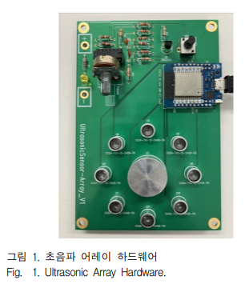

# w7_svm_PaperReview

상태: 완료
담당자: 노랑고흐

# 「초음파 어레이를 활용한 One-Class SVM 낙상 탐지」유지현·고진환. (2025).

[w7_svm_paper_review_박중현.pdf](w7_svm_paper_review_박중현.pdf)

> **요약**
> 
> 
> 낙상 데이터를 충분히 수집하기 어려운 상황에서, 정상 데이터만 학습한 OC-SVM이 정상·이상 데이터를 모두 학습한 TC-CNN과 유사한 낙상 탐지 성능을 보이는지 검증한 연구
> 

## 1. 연구 배경 및 문제 정의

#### **문제**

> 낙상 행동 예측(이상치 탐지)에 있어 데이터 수집 및 학습 과정에서 생기는 클래스 불균형으로 인한 성능 저하
> 

#### 목적

> 정상/이상 데이터의 클래스 불균형 문제를 정상 데이터 기반 OC-SVM 모델의 실험 및 적합성 검증을 통해 활용 가능성을 확인
> 

---

## 2. 연구 목적 및 비교 모델

초음파 어레이를 이용하여 정상 동작과 이상 동작인 낙상을 구분하고, 

정상 데이터만 학습하는 OC-SVM이 데이터 불균형 상황에서 활용 가능한지를 검증

세 가지 모델의 성능을 비교

| 모델 | 학습 데이터 | 기본 원리 |
| --- | --- | --- |
| **TC-CNN** | 정상 + 이상 데이터 | 두 클래스의 차이를 직접 학습하여 정상과 이상 분류 |
| **OC-CNN** | 정상 데이터만 사용 | 정상 데이터의 출력이 0에 가까워지도록 학습 |
| **OC-SVM** | 정상 데이터만 사용 | 정상 데이터의 영역을 설정하고 영역 밖 데이터를 이상으로 판단 |

---

## 3. 기존 연구 검토

논문에서는 카메라, 가속도 센서, 레이더 및 초음파를 이용한 기존 낙상 탐지 방식을 검토

| 탐지 방식 | 장점 | 한계 |
| --- | --- | --- |
| 카메라 | 딥러닝을 활용한 높은 탐지 정확도 | 사생활 침해, 저조도 환경의 성능 저하 |
| 가속도 센서 | 신체 움직임을 직접 측정 | 신체에 센서를 부착해야 함 |
| 레이더 | 비접촉 방식으로 탐지 가능 | 높은 비용, 환경 간섭에 취약 |
| 초음파 어레이 | 비접촉·저비용, 사생활 보호 | 본 논문에서는 센서 자체의 구체적 한계를 별도로 제시하지 않음 |

### 초음파 어레이의 장점

초음파 센서는 신체에 장치를 부착하지 않고 대상을 감지할 수 있으며, 카메라처럼 사람을 직접 촬영하지 않아 사생활 보호에 유리하다. 또한 레이더와 달리 무선 주파수 규제를 받지 않고, 비용이 낮으며 조명 조건의 영향을 적게 받는다.

---

## 4. 데이터 수집 방법

### 4.1 초음파 어레이 구성

연구에 사용된 초음파 어레이는 다음과 같이 구성되었다.

- 송신용 초음파 트랜스듀서 8개
- 수신용 트랜스듀서 1개
- 송신 주파수 40kHz
- 송신기는 원형으로 배치하고 수신기는 중앙에 배치

### 4.2 데이터 전처리

수집된 초음파 신호는 다음 과정을 거쳐 모델의 입력 데이터로 변환

> 초음파 신호 수집
> 
> 
> → 1초마다 이미지 1장 생성
> 
> → 5초 동안 이미지 5장 저장
> 
> → 각 이미지를 128×128 크기로 조정
> 
> → 5장을 128×128×5 데이터로 결합
> 

### 4.3 수집 동작

모든 동작은 인체 모형을 이용하여 센서로부터 30cm, 50cm, 100cm 거리에서 수행

**정상 동작 6종**

- 좌측에서 우측으로 이동
- 우측에서 좌측으로 이동
- 좌우 방향으로 무작위 이동
- 누운 상태에서 일어나기
- 허리를 숙였다가 일어나기
- 센서 앞에 사람이 없는 무인 상태

**이상 동작 2종**

- 정지 상태에서 넘어지는 동작
- 이동 중 넘어지는 동작

**훈련 데이터 표**

---

## 5. 알고리즘 개념 정리 (부록)

### CNN

CNN은 합성곱 계층을 이용하여 이미지의 선, 형태, 경계와 같은 특징을 자동으로 추출하는 신경망이다. 사람이 직접 특징을 지정하지 않아도 이미지에서 필요한 특징을 학습할 수 있다는 장점이 있다.

### TC-CNN

- TC-CNN은 정상 데이터와 이상 데이터를 모두 학습
- 마지막 출력층에서 정상과 이상에 해당하는 두 개의 값을 출력하고
- Softmax를 통해 최종 클래스를 결정

### OC-CNN

- 원래 OC-CNN은 정상 데이터와 정규분포에서 생성한 가상 데이터를 함께 학습하는 방식
- 그러나 이를 본 연구의 초음파 데이터에 적용했을 때 정상과 이상 동작을 구분하지 못함
- TC-CNN 구조를 기반으로 출력 뉴런을 1개로 변경,
- 손실함수를 평균제곱오차인 MSE로 설정.
- 학습 단계에서는 정상 데이터만 입력하여 모델 출력이 0에 가까워지도록 학습
- , 테스트 단계에서는 출력값이 임계값을 초과하면 이상으로 판단

### SVM과 OC-SVM

- 일반적인 SVM은 클래스 사이의 거리가 가장 넓어지도록 결정 경계를 찾는 알고리즘
- 데이터가 직선으로 구분되지 않을 경우에는 커널을 이용하여 비선형 경계를 형성
- OC-SVM은 정상과 이상 사이의 경계를 직접 학습하는 대신, 정상 데이터가 위치하는 영역을 학습. 새로운 데이터가 정상 영역 내부에 있으면 정상으로, 영역 밖에 있으면 이상치로 판단

---

## 6. 모델 설계

### 6.1 신경망 구조 실험

- ResNet50, ResNet18, AlexNet과 연구진이 직접 제작한 신경망을 비교.
- 초음파 데이터의 복잡도가 높지 않아 깊은 신경망일수록 정확도가 오히려 감소했으며, 상대적으로 얕은 구조가 안정적인 성능을 보임.
- 이에 따라 초음파 데이터에 맞는 단순한 CNN을 설계.
- <u>**OC-SVM에서는 Linear, Polynomial, RBF 세 가지 커널을 적용하여 성능을 비교**</u>

### 6.2 TC-CNN과 OC-CNN의 공통 구조

두 CNN 모델은 동일하게 세 단계의 특징 추출 블록을 사용

> 이미지 입력
> 
> 
> → 합성곱 계층
> 
> → 배치 정규화
> 
> → ReLU
> 
> → 맥스 풀링
> 
> → 완전 연결 계층
> 
> → 드롭아웃 0.5
> 
> → 최종 출력
> 

1. **제작한 TC-CNN 신경망 구조**

1. **제작한 OC-CNN 신경망 구조**

- 초기 두 블록에서는 맥스 풀링을 적용하여 이미지 크기를 줄임
- 완전 연결 계층에서 추출된 특징을 통합
- 드롭아웃은 특정 학습 데이터만 외우는 **과적합**을 줄이기 위해 사용
- 두 모델의 차이는 최종 출력층에 있음

| 구분 | TC-CNN | OC-CNN |
| --- | --- | --- |
| 출력 뉴런 | 2개 | 1개 |
| 출력 형태 | 정상·이상 클래스 | 하나의 연속적인 값 |
| 최종 계층 | Softmax 분류 계층 | 회귀 계층 |
| 학습 데이터 | 정상 + 이상 | 정상만 사용 |

---

## 7. 데이터셋 구조

| 데이터 구분 | 정상 | 이상 | 합계 |
| --- | --- | --- | --- |
| TC-CNN 훈련 데이터 | 2,400 | 570 | 2,970 |
| OC-CNN·OC-SVM 훈련 데이터 | 2,400 | 0 | 2,400 |
| 검증 데이터 | 400 | 150 | 550 |
| 테스트 데이터 | 400 | 150 | 550 |
- TC-CNN은 정상과 이상 데이터를 모두 학습,
- OC-CNN과 OC-SVM은 정상 데이터만 학습

---

## 8. 평가 척도 및 테스트 결과

모델 평가는 정확도, 정밀도, 재현율, F1-Score를 이용

### 최종 성능 비교

- TC-CNN이 가장 높은 성능을 보였지만 정상과 이상 데이터를 모두 학습에 사용했다.
- 반면 **RBF 커널 기반 OC-SVM은 정상 데이터만 학습했음에도 TC-CNN과 거의 유사한 성능을 기록**
- OC-CNN은 정상 데이터만 학습할 수 있다는 장점은 있었지만, 정확도와 F1-Score 모두 상대적으로 낮았다. OC-SVM에서는 Linear와 Polynomial 커널의 성능이 낮았으며, RBF 커널을 적용했을 때 가장 높은 성능이 나타났다.

---

## 9. 결론

본 연구는 초음파 어레이를 통해 수집한 신호를 이미지로 변환하고, TC-CNN, OC-CNN, OC-SVM을 적용하여 정상 동작과 낙상 동작을 구분하였다.

실험 결과 정상·이상 데이터를 모두 학습한 TC-CNN이 99.82%로 가장 높은 정확도를 기록하였다. 그러나 정상 데이터만 학습한 OC-SVM도 99.64%의 정확도와 0.9933의 F1-Score를 기록하여 TC-CNN과 유사한 성능을 보였다.

따라서 낙상처럼 이상 데이터가 적고 수집하기 어려운 환경에서는, 정상 데이터만으로 학습할 수 있는 OC-SVM이 클래스 불균형 문제를 완화하는 현실적인 대안이 될 수 있다. 또한 초음파 센서는 비접촉 방식이며 대상을 직접 촬영하지 않기 때문에, 사용자 편의성과 사생활 보호 측면에서도 활용 가능성이 있다고 결론 내림.
